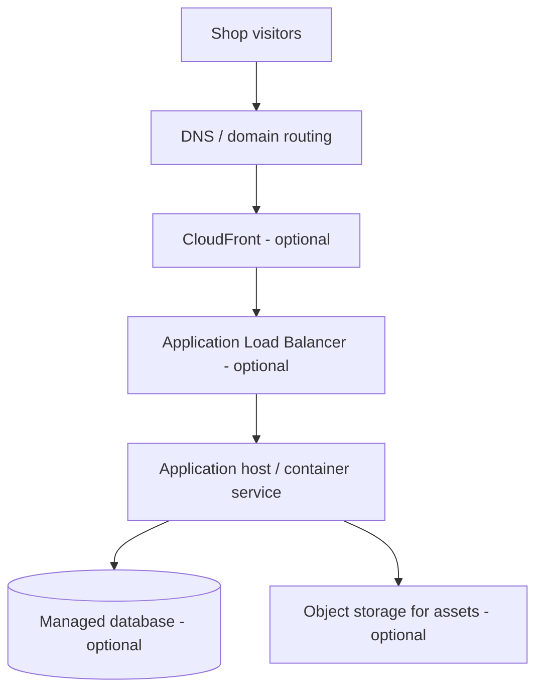

# AWS EverShop Cloud Deployment & Internship Training Portfolio

> **Status:** Training deployment completed previously; AWS resources have been deleted to prevent ongoing costs. This repository documents the training project and provides a structured learning record. **No live application URL is available.**

This repository is a portfolio and technical documentation companion for an EverShop cloud deployment exercise. It records cloud concepts, deployment workflow, architecture, task notes, verification checklists, cost considerations, and troubleshooting. It is not a claim that the infrastructure is currently running.

## Project objectives
- Understand the steps involved in hosting an e-commerce application on AWS.
- Learn cloud compute, networking, storage, database, container, delivery, security, and monitoring concepts.
- Document the deployment lifecycle and operational considerations.
- Practice writing clear technical documentation and troubleshooting notes.
- Keep evidence and configuration examples organized without exposing secrets.

## Project status & transparency
- **Training deployment:** performed during training; AWS environment was later cleaned up.
- **Live demo:** unavailable because cloud resources are not running.
- **Evidence:** add only screenshots, logs, or outputs that you personally captured during training. Do not create fabricated console screenshots.
- **Implementation details:** review task pages and edit them to match the exact services, settings, and steps you personally used. Some sections are learning/reference notes, not claims of completed hands-on work.

## Architecture (illustrative reference)
The diagram below is a conceptual example, not a verified record of the exact training environment. Update it to match the architecture you actually deployed.




## Technology areas
| Area | Technologies / concepts |
|---|---|
| Application | EverShop, Node.js-based application (verify version used in training) |
| Compute | Amazon EC2; ECS concepts where applicable |
| Containers | Docker, Docker Compose, image lifecycle |
| Database | RDS; PostgreSQL/MySQL depends on deployment configuration |
| Networking | VPC, subnets, routes, security groups, public/private access |
| Storage | Amazon S3, bucket access controls, lifecycle policies |
| Delivery | CloudFront, DNS, TLS/HTTPS concepts |
| CI/CD | Build, test, image publishing, deployment pipeline concepts |
| Operations | CloudWatch metrics/logs, health checks, troubleshooting, cost cleanup |

## Repository map
```text
.
├── docs/                       # Architecture, costs, troubleshooting
├── tasks/                      # Task-wise learning and deployment notes
├── config/examples/              # Safe sample configs (no secrets)
├── media/screenshots/             # Add your own training evidence
└── .github/workflows/             # Optional repo automation examples
```

## Task documentation
| Task | Topics | Status |
|---|---|---|
| [01 - EC2](tasks/task-01-ec2/README.md) | Virtual server, SSH, installation, security groups | Document actual steps/evidence |
| [02 - RDS](tasks/task-02-rds/README.md) | Database provisioning, access, backups | Match training setup |
| [03 - Networking & security](tasks/task-03-networking-security/README.md) | VPC, subnets, routes, SGs | Learning notes / actual config |
| [04 - Docker](tasks/task-04-docker/README.md) | Images, containers, Compose | Record commands used |
| [05 - ECS & ECR](tasks/task-05-ecs-ecr/README.md) | Container registry and orchestration | Reference notes unless personally performed |
| [06 - S3 & CloudFront](tasks/task-06-s3-cloudfront/README.md) | Object storage and CDN | Reference notes unless personally performed |
| [07 - CI/CD](tasks/task-07-cicd/README.md) | Build and deployment automation | Record actual pipeline, if used |
| [08 - Monitoring](tasks/task-08-monitoring/README.md) | Logs, metrics, health checks | Record actual monitoring work |

## Documentation
- [Architecture overview](docs/architecture/overview.md)
- [Deployment lifecycle](docs/deployment-lifecycle.md)
- [Cost management and cleanup](docs/cost-management/README.md)
- [Troubleshooting](docs/troubleshooting/README.md)
- [Evidence checklist](docs/evidence-checklist.md)

## Screenshots and evidence
Place genuine screenshots in `media/screenshots/` or the relevant task's `screenshots/` folder. Before uploading, blur or remove account IDs, public IPs, email addresses, access keys, tokens, database passwords, and other sensitive details. Use descriptive filenames and link them from task documentation.


## How to use this repository
1. Read the task overview and architecture notes.
2. Replace generic text with details from your own training deployment.
3. Add screenshots and command outputs you personally saved.
4. Mark each task as **Completed during training**, **Documented**, **Practiced locally**, or **Reference only** as appropriate.
5. Never commit secrets or real customer data.


## Cost and safety
AWS resources can incur charges even when an application is not actively used. This repo includes a cleanup checklist, but always verify resources in every AWS Region and check Billing/Cost Explorer. Do not create expensive resources just to reproduce a diagram.


## Disclaimer
This is an individual learning/portfolio documentation repository. EverShop and AWS are respective owners' products/marks. This repository does not contain the EverShop application source code. Service lists and architecture drawings are educational examples unless explicitly labeled as verified training work.
