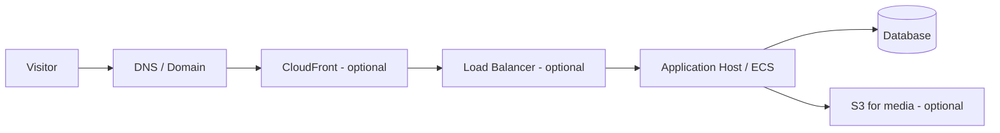

# Architecture overview (illustrative)

**Important:** This is a conceptual reference diagram. Confirm and edit it to represent the architecture used during your training. Optional services are not evidence that you deployed them.

## Components to understand
- **Compute:** where the application process or container runs.
- **Networking:** how requests enter the environment and how services communicate.
- **Database:** persistent application data; restrict network access to application sources.
- **Object storage:** static assets or uploads, with access policy and lifecycle decisions.
- **Delivery:** caching and TLS termination where configured.
- **Monitoring:** logs, metrics, health checks, alarms, and troubleshooting.

Update this page with the actual components, region, ports, and flow from your deployment. Do not publish account IDs, credentials, private IP details, or sensitive configuration.
